<p align="center">
  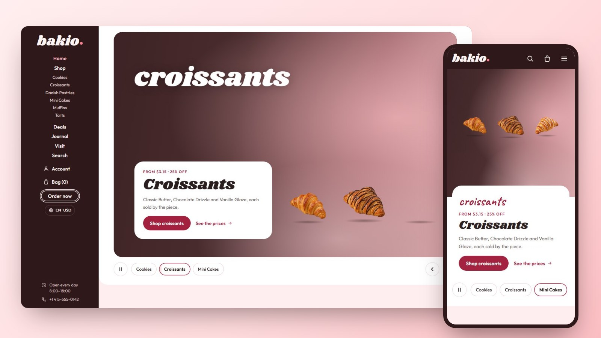
</p>

<h1 align="center">Galio Sundae Patisserie</h1>

<p align="center">
  <b>A single bakery as a pastry parlour in one colour family: white pages, tinted bands and round plates from the chosen palette (cherry by default), a straight side rail in the family's near-black, and one shape language: circles, pills and 28px panels, with a scalloped awning only under each page's title.</b><br>
  A custom Selldone Layout built on the official <a href="https://github.com/selldone/storefront">selldone/storefront</a>.
</p>

<p align="center">
  <a href="https://galio.selldone.shop"></a>
  <a href="https://github.com/selldone-custom-layouts/official-galio/wiki"></a>
  <a href="https://github.com/selldone-custom-layouts/official-galio/wiki/Install-with-AI"></a>
  
  
  
</p>

<p align="center">
  <a href="https://galio.selldone.shop"><b>Open the live shop</b></a> ·
  <a href="https://github.com/selldone-custom-layouts/official-galio/wiki/Install-with-AI">Set it up with AI</a> ·
  <a href="https://github.com/selldone-custom-layouts/official-galio/wiki/Manual-Setup">Manual setup</a> ·
  <a href="https://github.com/selldone-custom-layouts/official-galio/wiki/Shop-Requirements">What your shop needs</a> ·
  <a href="https://github.com/selldone-custom-layouts">All Selldone custom layouts</a>
</p>

---

## What it is

**Galio Sundae Patisserie** dresses a single pâtisserie as a pastry parlour in one colour family: white pages taking turns with tinted section bands, a straight side rail in the family's near-black, a scalloped awning under each inner page's title band, a hero slider of the best-selling collections, a price list with dot leaders, and every pastry on a round plate in the family's tint. It was drawn for **Bakio**, a bakery that sells individual pastries for courier delivery, worldwide shipping and pickup at its counter, paid in cash on delivery.

- **one colour family**: every colour comes from one hue, the chosen palette's, plus white and the family's near-black. White pages and light tints of the hue for the bands, the plates and the buy box; the near-black for the rail, the top bar, the banner band and the footer. Switching the palette re-tints the whole page, not just the buttons;
- **one** action colour for every button, chosen state and link (cherry `#a3213f` by default); the saving stickers, the journal's date roundels and the wordmark's dot wear it too, and there is no yellow unless the palette is yellow;
- Shrikhand (a fat retro display face) for headings and the wordmark, Outfit for text, Caveat for the handwritten kickers over each heading; inline line icons, and a line drawing for each collection;
- pastries as cut-outs on round plates in the family's tint, with a tilted saving sticker whose words always fit inside its circle;
- flat pill buttons, hover changes the colour only, no line under any word or icon, selection rings inside the box;
- light by default, with a dark mode that is the same family's night; a **Theme** row in the footer on the showcase shop: four palettes (Cherry, Pistachio, Blueberry, Cocoa), a **Custom colour** and Light / Dark;
- it says **bag**, never cart; every word it writes is in English, with an Arabic (right to left) dictionary ready for a shop that sells in Arabic.

It runs on **[galio.selldone.shop](https://galio.selldone.shop)**, one domain of the Selldone shop Bakio. Selldone lets each domain of a shop carry its own Layout, so Galio is pinned on that address alone; the shop's default Layout (Bakini Noir) is not changed by it.

Everything is read live from the shop: its title (drawn as the wordmark), collections, products, prices and savings, delivery ways and their time windows, the pickup counter and its hours, the way to pay, the articles. Nothing about Bakio is written in the code, so another bakery that imports the Layout gets its own data. Selldone's own bag, checkout, payments and orders keep working underneath.

## Screenshots

| Desktop | Phone |
| --- | --- |
| 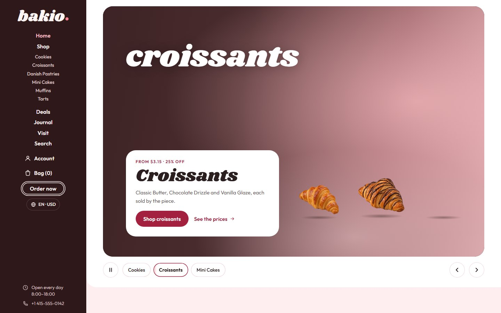 | 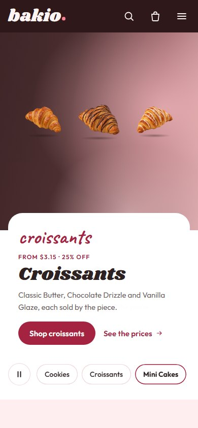 |
| 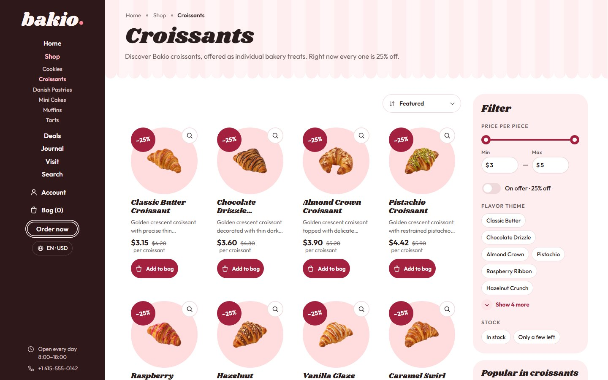 | 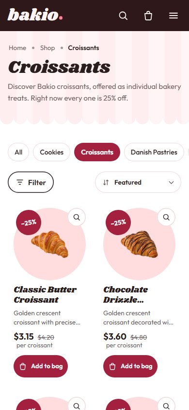 |
| 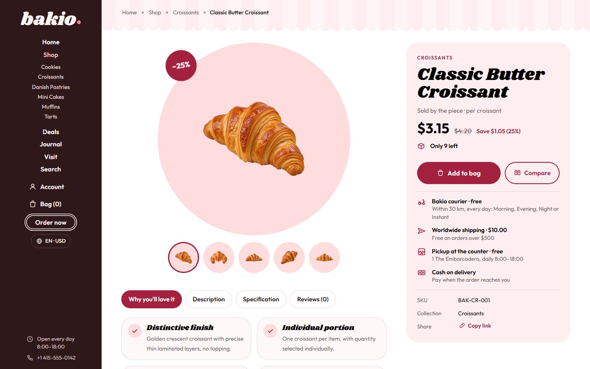 | 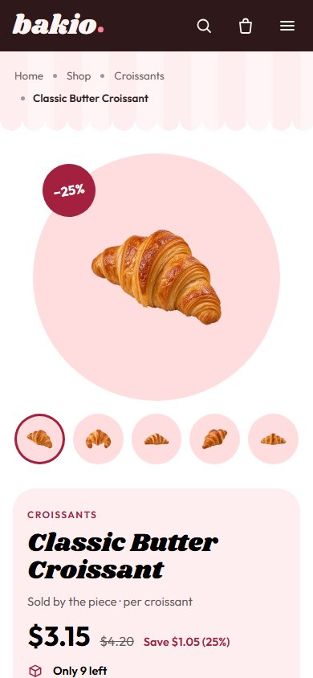 |
| 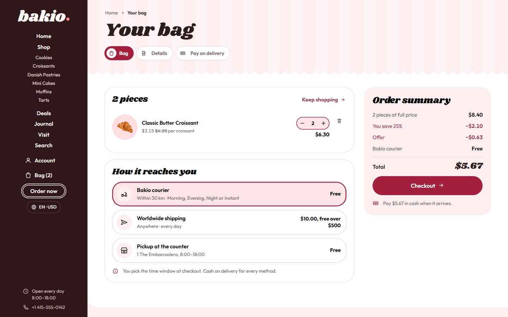 | 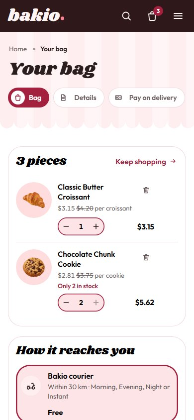 |
| 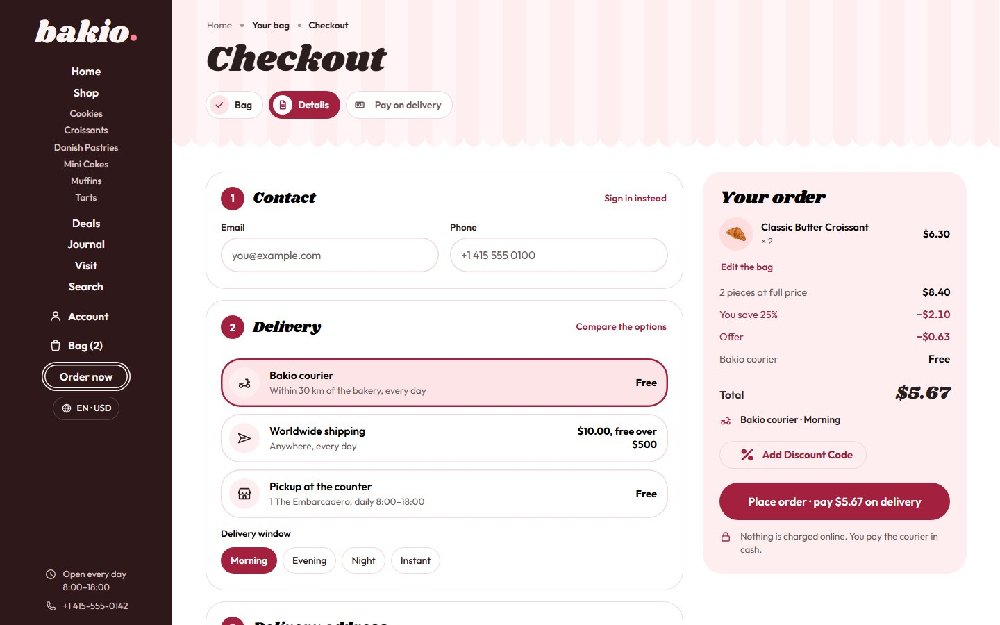 | 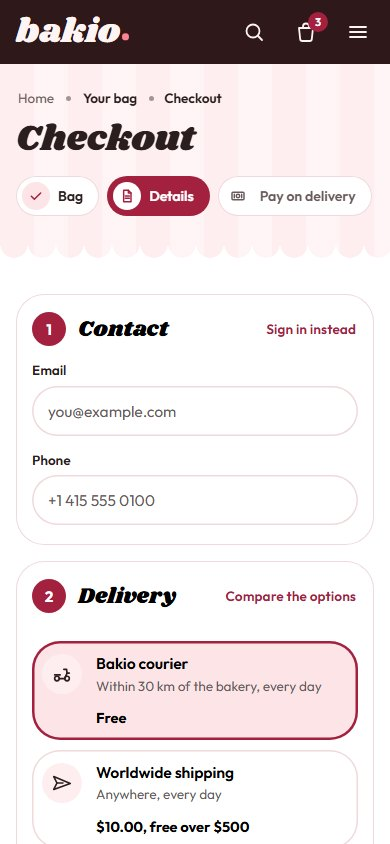 |
| 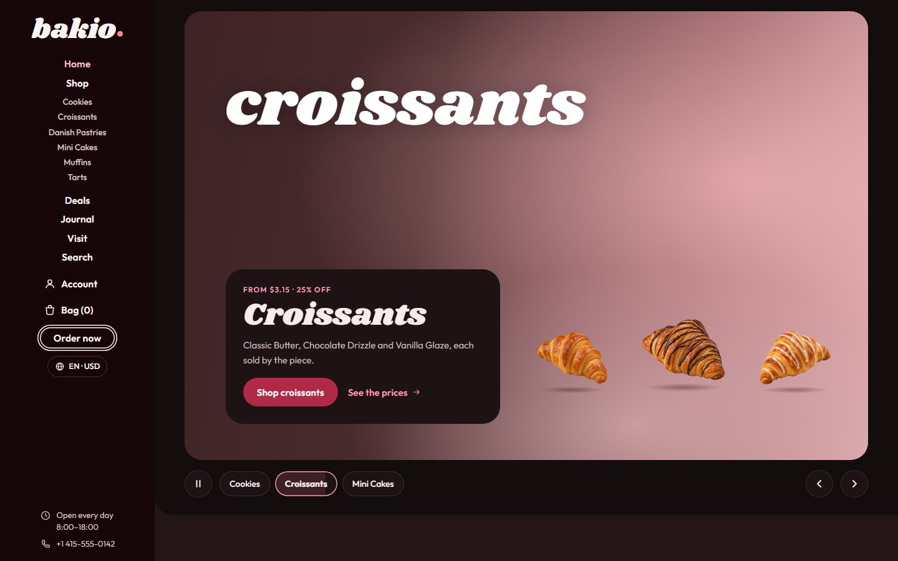 | 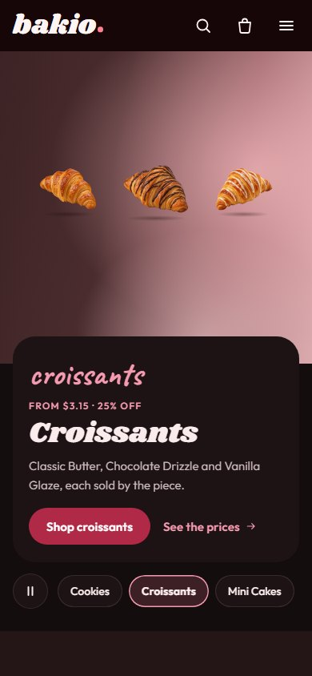 |

## Highlights

- **Side rail and top bar:** from 1100px wide, a fixed rail in the family's near-black, a straight column flush with the window (where a band meets it beside white page, a 28px rounded join): the wordmark (the shop's title), Home, **Shop** (a collections menu beside the rail: every collection with its line drawing and "From $x", Shop all pastries, Deals and the three pieces ordered most), Deals, Journal, Visit, Search, Account, **Bag (n)**, **Order now**, the **EN · USD** language and currency pill, and the counter's days, hours and phone at its foot. Below 1100px: a sticky top bar in the same near-black (the wordmark, search, the bag with its count, the menu) and a menu sheet (Home, Shop all, Deals, the collections with their "from" prices, the bakery's pages, Account and a **Language & currency** row).
- **Home:** a hero slider of up to three collections (those with their own photo first, then by sales), each with its title as the script word fitted to one line, "From $x" (with the saving when every piece shares one) and its three best sellers; filling tabs, pause and play, and it pauses on hover, on keyboard focus, in a hidden tab and for reduced motion. Then **Pick your pastry** (every collection with its line drawing on a white disc, on a light family band), **How it reaches you** (a mosaic of the shop's real ways: courier, the way to pay, shipping, the pickup counter), **Today's prices** (a price list per collection with dot leaders and a round +, on white), **Sold by the piece** (the banner, on the family's near-black), **Best sellers** (the eight most sold, on a light family band), **Visit the counter** (a real map of the shop's place with its address, hours, phone, directions and "Order for pickup") and **From the journal** (the four newest posts, on the family's lightest tint) last.
- **Listings:** a collection, a search, the deals and all pastries: a title band, collection chips, real spec filters in a side panel (a sheet on a phone; a key becomes a filter only when it has two or more short values; Price, On offer and In stock always), Sort and a loading fade.
- **Card:** the cut-out on its round plate in the family's tint, the tilted saving sticker, a quick-look button, the collection, the name, a short line about it, "per <unit>", the price and the price before, and "Add to bag" that turns into "− n +" in place.
- **Product page:** a gallery on a plate in the family's tint with round thumbnails; a buy column that stays in view (price, saving, a deal clock only when the deal really ends, stock, options only when the product has real variants, Add to bag, Compare, delivery, pickup, shipping and payment lines, SKU and Copy link) and a buy bar on a phone; tabs for **Why you'll love it** (the product's pros), Description, Specification (the shop's spec groups) and Reviews (an honest empty state with the shop's rating criteria until the first review); **Buy together** and **More <collection>**.
- **Compare and quick look:** the picks side by side with their plates and buy controls, "Add a pastry", the shop's spec groups, Why pick it, reviews and "Only differences"; a quick look dialog (a bottom sheet on a phone).
- **Bag and checkout:** a bag drawer with "Often added" and a receipt that shows a shop offer as its own line; the bag page with step pills and "How it reaches you"; the checkout as numbered cards (contact, delivery method cards with the shop's time windows, the address or the pickup counter, billing, a note, coupons when the shop has some), a delivery sheet, an address sheet with or without a map, and Selldone's payment window in Galio's dress. A shop without a payment method gets "This shop is not taking payment right now" instead of a dead button.
- **Orders and account:** the order page (a track card with the state, the way and window, what is paid or to pay and four steps; the pieces with Selldone's sums; payment, delivery and receiver; a chat with the bakery); the account as a desk (Overview, Orders, Addresses, Profile, with Selldone's other sections under the menu); a guest gets a sign-in entry with "Continue as guest"; a sign-in dialog without Selldone branding.
- **Pages:** the journal (the newest post large, then every post with a date roundel) and each post (its column, **Shop this post**, share, comments, Read next); About and Contact with the real map; Terms, Privacy and Questions (sample text marked as such until the shop writes its own); a 404 inside the Layout.
- **Footer:** the footer in the family's near-black: the wordmark and a line about the shop from its own data, a **newsletter** form on Selldone's own audience list, the links, phone and email, the Theme row (showcase only) and a legal row with Selldone's cookie settings and social links, the way to pay and the ways an order travels.

## Tests

Every check runs one browser at a time against the shop, at 1440px and 390px (and 1100px, the rail's first width, where a check takes widths), dark and light, and in Arabic (right to left) on the dev server. Because a palette re-tints every ground, the contrast check also runs in Pistachio, Blueberry and Cocoa, light and dark, and with the custom colours `#ffff00`, `#00ffff` and `#111111` in both modes. Each is delivered at **TOTAL 0**.

<!-- TESTS:START -->
Live shop **galio.selldone.shop**, Layout version **1.0.4**, 14 November 2026 (`bash scripts/run-checks.sh https://galio.selldone.shop <logs>`, one check at a time). Every check below is **TOTAL 0**; the rest of the suite (ring, card edge, corner clear, circle fit, box, underline, contrast with layers open) is TOTAL 0 on the dev server for the same source and was TOTAL 0 live on 1.0.1 and 1.0.2.

| Check | What it looks for | Where | TOTAL |
| --- | --- | --- | --- |
| Contrast, every palette | every word at 4.5:1 or better on what is really behind it | Pistachio, Blueberry and Cocoa, light and dark, 9 pages at 1440, 1100 and 390 | **0** |
| Contrast, custom colours | the same, with a visitor's own colour | #ffff00, #00ffff and #111111, light and dark | **0** |
| Contrast in Arabic | the same, right to left | light and dark, 9 pages | **0** |
| Contrast with the sign-in sheet | the sheet open | dark and light | **0** |
| Bag audit | the drawer, the bag page and the address sheet | dark and light, 1440 and 390 | **0** |
| Filled checkout | the checkout with a piece in the bag and Selldone's payment window | light and dark, 1440, 1100 and 390 | **0** |
| Currency | every price, filter and total follows the picked currency at once | home, collection, deals, drawer, menus | **0** |
| Arabic words | every word of the Layout in Arabic, the page right to left | 9 pages, the drawer, the bag, compare, account | **0** |
| Shapes (light, dark) | every edge a circle, a pill, 28 or 14 px; focus rings keep their shape; nothing past the window | 16 pages with their overlays open (menu, flyout, search, region, bag, filter, quick view, sign-in) and the checkout, delivery sheet, address sheet and payment window, 1440, 1100 and 390 | **0** |

Bakio sells in English only, so the Arabic checks offer Arabic in the test browser only (`scripts/pw-shop-languages.cjs` adds it to the shop's languages as the shop-info call comes in); the page is the live production bundle.

**Guest checkout walk** (`scripts/galio-checkout-walk.mjs`, 1440 and 390): one piece from a home card, the bag drawer, Checkout, fake contact details, each of the shop's ways (courier with its Morning, Evening, Night and Instant windows, worldwide shipping, pickup at the counter), the delivery sheet, the address sheet with the map off and on, then "Place order" up to Selldone's payment window, which is closed with its ✕. Every way reaches the payment window on both widths. No order was placed.
**1.0.5** (live on galio.selldone.shop, release `01M7DGEQ298YGGABCXE3Y9JADZ`): focus without outlines, one ring per control. `scripts/shape-check.cjs` now clicks and tabs into every field of every page and overlay; on dev the focus-related checks (ring, underline, contrast with layers open, shapes with the field test) are TOTAL 0, and the uploaded release passes the field test on the collection page and its filter sheet.
<!-- TESTS:END -->

## Languages

Every word Galio writes goes through `t("key", "English")` ([`components/kalio/i18n/`](components/kalio/i18n/)): the shared Kalio words in `base/<lang>.ts`, the Bakini words Galio still uses in `bakini.<lang>.ts` and Galio's own in `galio.<lang>.ts`. Bakio sells in English only; the Arabic dictionary is ready for a shop that enables Arabic, loads only when a visitor picks it and turns the whole page right to left. To add a language, translate `galio.en.ts`, `bakini.en.ts` and `base/en.ts` into `<code>` files and register them in `index.ts`; the wiki page [Customize](https://github.com/selldone-custom-layouts/official-galio/wiki/Customize) has the steps.

## Theme and colours

Galio runs the shared theme switcher (`components/theme-switcher/`, the same code as the other custom Layouts). On your own shop the visitor switcher is hidden, and Galio shows the theme you set in **one file**, [`components/galio/galio-theme.settings.ts`](components/galio/galio-theme.settings.ts): a palette (`cherry`, `pistachio`, `blueberry`, `cocoa`) or any brand colour (`brandColor: "#F5C400"`; a light colour keeps dark words on it with `textOnBrand: "auto"`), `light` or `dark`, and whether your visitors get the switcher (`themeSwitcher: "showcase" | "on" | "off"`). Every colour is made readable automatically. Galio builds **one colour family** from that colour (`components/galio/galio-family.ts`), so a palette or a brand colour re-tints the grounds, bands, plates, rail and footer as well as the buttons; dark mode is the same family's night. An AI agent finds the steps in the "Theme" section of [`AGENTS.md`](AGENTS.md); the wiki page [Theme and colours](https://github.com/selldone-custom-layouts/official-galio/wiki/Theme-and-colours) has the details.

## Use it on your shop

| You want to… | Read |
| --- | --- |
| Let an AI agent (Claude Code, Codex…) set it up for your shop | [Install with AI](https://github.com/selldone-custom-layouts/official-galio/wiki/Install-with-AI) |
| Do it yourself, step by step | [Manual Setup](https://github.com/selldone-custom-layouts/official-galio/wiki/Manual-Setup) |
| Know what data your shop needs for the design to look right | [Shop Requirements](https://github.com/selldone-custom-layouts/official-galio/wiki/Shop-Requirements) |
| Build, upload and verify a release | [Build and Upload](https://github.com/selldone-custom-layouts/official-galio/wiki/Build-and-Upload) |
| Put the Layout live on one domain of your shop, or on the whole shop | [Go Live](https://github.com/selldone-custom-layouts/official-galio/wiki/Go-Live) |
| Change the name, sections, pages, photos or languages | [Customize](https://github.com/selldone-custom-layouts/official-galio/wiki/Customize) |
| Change the colours, light or dark, the visitor switcher | [Theme and colours](https://github.com/selldone-custom-layouts/official-galio/wiki/Theme-and-colours) |
| Fix a blank page, a rejected upload or an old version showing | [Troubleshooting](https://github.com/selldone-custom-layouts/official-galio/wiki/Troubleshooting) |

The wiki's source is also in [`docs/wiki/`](docs/wiki/).

## Quick start (developers)

```bash
git clone https://github.com/selldone-custom-layouts/official-galio.git
cd official-galio
npm run setup            # the six Selldone modules (modules/)
for p in components translate; do git -C modules/$p apply ../../patches/modules-$p.kalio.patch; done
npm install --force
npm run serve            # dev server on http://localhost:9145, reading the shop named in .env
```

`.env` names the shop the dev server reads (`VITE_APP_SAMPLE_SHOP_NAME=bakio`). The first page load after a start compiles for a minute or more. Releases:

```bash
LAYOUT_ID=<your Layout id> SELLDONE_CLI_SRC=<cli clone> bash scripts/release.sh <new version> desk
```

Leave `LAYOUT_ID` out on the first upload; use the id printed after it from then on. Never reuse a version number. Before it uploads, the script loads the built bundle in a headless browser and stops on any error, so it needs Playwright (`PW=<path>/node_modules/playwright/index.js`). See [Build and Upload](https://github.com/selldone-custom-layouts/official-galio/wiki/Build-and-Upload).

## Where things are

| Area | Files |
| --- | --- |
| Your theme (palette, brand colour, mode, switcher) | [`components/galio/galio-theme.settings.ts`](components/galio/galio-theme.settings.ts) |
| The palettes and the switcher's config | [`components/galio/galio-theme.ts`](components/galio/galio-theme.ts) |
| The one colour family, computed from the palette for light and dark and written on `<html>` | [`components/galio/galio-family.ts`](components/galio/galio-family.ts) |
| The mockup's stylesheets for both modes, scoped to `.gl` (generated by [`scripts/galio-css.cjs`](scripts/galio-css.cjs)) | [`style/galio/`](style/galio/) (`b.css` holds the mockup's base tokens; `one.css` carries the Cherry family for the first paint and maps the tokens onto the family) |
| The Layout's own touches | [`style/galio.scss`](style/galio.scss) (shell, home, shop, product, reading pages), [`style/galio-buy.scss`](style/galio-buy.scss) (bag, checkout, sheets, payment window, account, order) |
| Shared data and helpers (collections, catalogue, the shop's facts, layers), icons, photo slots | [`components/galio/`](components/galio/) (`gl-data.ts`, `galio.ts`, `gl-icons.ts`, `gl-photos.ts`, `Gl*.vue`) |
| Side rail, top bar, menu sheet, collections menu, search, bag drawer, quick look, sign-in, footer | [`components/galio/shell/`](components/galio/shell/) |
| Home | [`components/galio/home/GlHome.vue`](components/galio/home/GlHome.vue), [`GlHero.vue`](components/galio/home/GlHero.vue), [`GlMap.vue`](components/galio/home/GlMap.vue) |
| Collections, search, deals (filters and sort) | [`components/galio/shop/`](components/galio/shop/), [`pages/products/`](pages/products/) |
| Product page and compare | [`components/galio/product/`](components/galio/product/), [`components/galio/compare/`](components/galio/compare/), [`pages/product/`](pages/product/) |
| Bag, checkout, order, account | [`components/galio/buy/gl-cart.ts`](components/galio/buy/gl-cart.ts), [`components/galio/account/`](components/galio/account/), [`components/kalio/`](components/kalio/), [`pages/basket/`](pages/basket/), [`pages/user/`](pages/user/) |
| Journal, post, About, Contact, Terms, Privacy, Questions, 404 | [`components/galio/read/`](components/galio/read/), [`pages/blog/`](pages/blog/), [`pages/official/`](pages/official/), [`pages/faq/`](pages/faq/), [`pages/errors/`](pages/errors/) |
| The wordmark and the tab mark, from the shop's title; "bag" in Selldone's own strings | [`components/galio/GlMark.vue`](components/galio/GlMark.vue), [`components/kalio/kalio-brand.ts`](components/kalio/kalio-brand.ts) |
| Fonts | [`components/kalio/kalio-fonts.ts`](components/kalio/kalio-fonts.ts) |
| Words and languages | [`components/kalio/i18n/`](components/kalio/i18n/) |
| Language and currency pill | [`components/region-switcher/`](components/region-switcher/) |
| How the mockup became the Layout, data rules and releases | [`GALIO.md`](GALIO.md) |
| The checks | [`scripts/run-checks.sh`](scripts/run-checks.sh) and the tools it names |
| Release tooling, the production check | [`scripts/`](scripts/) (`release.sh`, `galio-prod-check.mjs`, `kalio-deploy.mjs`, `kalio-verify-deploy.mjs`) |
| Selldone storefront's original README | [`README.selldone.md`](README.selldone.md) |

Galio started from [Bakini Noir Patisserie](https://github.com/selldone-custom-layouts/official-bakini) 1.0.5 (history kept) and keeps the flows it solved: the bag, checkout, address and map sheets, payment, order, account and sign-in, the blog, compare, the i18n runtime, the region pill, the theme switcher row and the release scripts (the Kalio base: [`KALIO.md`](KALIO.md), [`BAKINI.md`](BAKINI.md)). Galio's own markup lives in `.gl` wrappers with the mockup's class names.

## Credits and license

Built on the official [Selldone Storefront](https://github.com/selldone/storefront) (MIT License, © Selldone); see [`LICENSE.md`](LICENSE.md). Part of **[Selldone Custom Layouts](https://github.com/selldone-custom-layouts)**.
