# Galio Sundae Patisserie

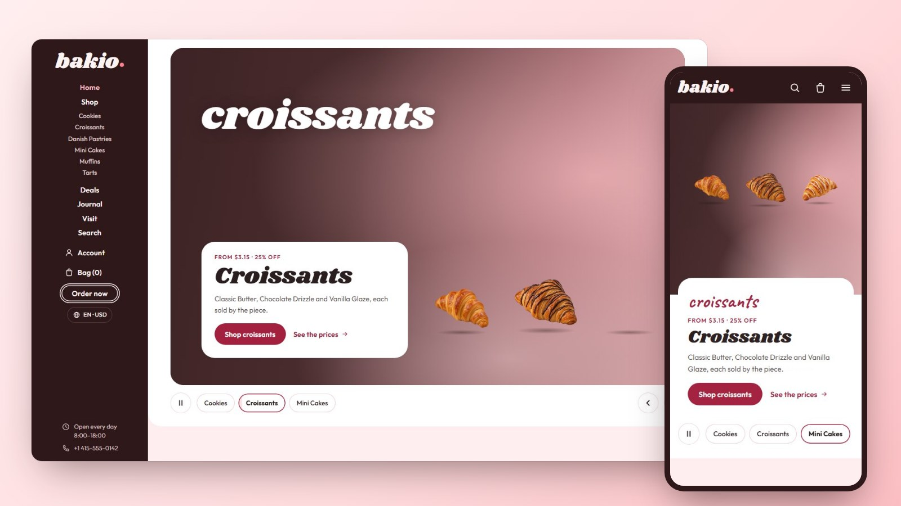

**Galio Sundae Patisserie** is a custom storefront **Layout** for Selldone shops: a single bakery dressed as a pastry parlour in one colour family. Every colour comes from one hue, the chosen palette's (cherry by default), plus white and the family's near-black: white pages taking turns with tinted bands, one action colour for every button, a straight side rail in the family's near-black, one shape language (circles, pills, 28px panels, 14px inner boxes) with the scalloped awning only under each inner page's title band, Shrikhand headings over Outfit with Caveat script kickers, and every pastry a cut-out on a round plate in the family's tint with a tilted saving sticker in the brand colour. A hero slider of the best-selling collections, line-drawn collections, a mosaic of the shop's real ways to get an order, a price list with dot leaders, best sellers, the real counter on a map and the journal; real spec filters; a product page with a buy column that stays in view and Buy together; a bag drawer, numbered checkout cards, a desk account and a 404 inside the Layout. Light is the default, with a dark mode in the same family; switching the palette re-tints the whole page. It says **bag**, never cart. Every word it writes is in English, and an Arabic (right to left) dictionary is ready for a shop that sells in Arabic.

It runs on **[galio.selldone.shop](https://galio.selldone.shop)**, one domain of the Selldone shop Bakio, pinned on that address alone; the shop's default Layout (Bakini Noir) is not changed by it (see [Go Live](Go-Live)). It is built on the official [selldone/storefront](https://github.com/selldone/storefront), so Selldone's basket, checkout, payments and orders keep working underneath a new design.

## Start here

| I want to… | Page |
| --- | --- |
| Have an AI agent set it up on my shop | **[Install with AI](Install-with-AI)** |
| Set it up myself | [Manual Setup](Manual-Setup) |
| Know what my shop's data needs | [Shop Requirements](Shop-Requirements) |
| Build, upload and verify a release | [Build and Upload](Build-and-Upload) |
| Put it live on one domain or my whole shop | [Go Live](Go-Live) |
| Change the name, sections, pages, photos, languages | [Customize](Customize) |
| Change the colours, light or dark, the visitor switcher | [Theme and colours](Theme-and-colours) |
| Fix a problem | [Troubleshooting](Troubleshooting) |

## How a Selldone Layout works (one minute)

1. A **Layout** is a complete storefront app (Vue 3) that runs on Selldone's own servers instead of the default storefront.
2. You build it, zip it, and **upload** it to your Selldone developer account with the official [selldone-cli](https://github.com/selldone/cli). Each upload is a new **version**.
3. You **attach** a version to your shop, or to one domain of it.
4. Selldone injects **your** shop into the Layout: its title, collections, products, prices, delivery ways, payment methods, articles, languages, currencies and settings. Nothing about Bakio is hard-coded: not the name (the wordmark is your shop's title), not a product photo (every pastry is your shop's own), not a delivery window or an opening hour. Another bakery that imports the Layout gets its own data.

## The look

| Part | Galio |
| --- | --- |
| Colour | **one colour family** from the chosen palette's hue, plus white and the family's near-black; a new palette re-tints the whole page, not just the buttons |
| Action colour | one colour for every button, chosen state and link: cherry `#a3213f` by default (white words 7.38:1) |
| Grounds | white pages and cards; bands that take turns between white and the family's light tints (Cherry `#ffeeef`, `#fff8f9`); the family's near-black (Cherry `#2e181a`) for the rail, the top bar, the banner and the footer; ink `#2a1e1f` |
| Accents | the saving stickers, the journal's date roundels and the wordmark's dot in the brand colour (on the dark bars, a light tone of it); no yellow unless the palette is yellow |
| Pastries | cut-outs on round plates, every plate in the family's plate tint (Cherry `#ffdcde`) |
| Collections | a line drawing each, matched by the collection's name (cookies, croissants, Danish, muffins, cakes, tarts; a generic pastry otherwise) |
| Type and icons | Shrikhand (headings, the wordmark, the hero's script word), Outfit (text and UI), Caveat (the handwritten kickers); inline line icons |
| Buttons | flat pills; hover changes the colour only; no line under any word or icon; selection rings inside the box |
| Layout | a fixed side rail in the family's near-black from 1100px, a straight column flush with the window, with 28px rounded joins where a band meets it beside white page; a sticky top bar and a menu sheet below |
| Shapes | one radius scale: circles (plates, stickers, icon discs, round buttons, swatches), pills (buttons, tabs, chips, inputs, list rows), 28px panels (cards, panels, the hero, photos, dialogs, drawers, sheets) and 14px inner boxes; focus rings keep the control's shape; the scallop hangs only from the inner pages' title band |
| Theme | light by default, a dark mode that is the same family's night; four palettes and a custom colour, each with its own family; a visitor switcher (a footer row) on the showcase shop only (see [Theme and colours](Theme-and-colours)) |
| Languages | English; an Arabic (right to left) dictionary ready; the language and currency pill in the rail |

## What you get

- **Side rail (1100px and wider):** the wordmark (your shop's title); Home; **Shop** (a collections menu beside the rail: every collection with its line drawing and "From $x", Shop all pastries, Deals and the three pieces ordered most); Deals; Journal; Visit (the home's map section); Search; Account; Bag (n), which opens the bag drawer; Order now; the **EN · USD** pill; the counter's days, hours and phone at its foot.
- **Top bar and menu (below 1100px):** the wordmark, search, the bag with its count and the menu. The menu sheet lists Home, Shop all, Deals, the collections with their line drawings and "from" prices (past eight, the first six and "Show N more"), the journal and the bakery's pages, the account and a "Language & currency" row that opens a panel over the sheet.
- **Footer:** the wordmark and one line about the shop from its own data, a newsletter form (Selldone's own audience list), the links (Home, Shop, Journal, About us, Contact, FAQ, Privacy, Terms of use), phone and email, the Theme row (showcase only) and the legal row.
- **Home:** the hero slider (up to three collections, those with their own photo first, then by sales; filling tabs, pause and play, and it pauses on hover, focus, a hidden tab and for reduced motion); Pick your pastry (a light family band); How it reaches you (a mosaic of your real ways: courier, the way to pay, shipping, the pickup counter); Today's prices (a price list per collection, on white); Sold by the piece (the banner, on the family's near-black); Best sellers (a light family band); Visit the counter with a real map; From the journal (the four newest posts, on the family's lightest tint) last.
- **Listings:** a collection, a search, the deals and all pastries. A title band, collection chips, real spec filters, Price, On offer and In stock, and Sort; on a phone a Filter button opens the panel as a sheet.
- **Cards:** the cut-out on its plate in the family's tint, the tilted saving sticker, a quick-look button, the collection, the name, a short line about it, "per <unit>", the price and the price before, and "Add to bag" that turns into "− n +" in place.
- **Product page:** the gallery with round thumbnails and a buy column that stays in view (price, saving, stock, options when the product has them, "Add to bag", Compare, delivery, pickup, shipping and payment lines, SKU, Copy link); a phone buy bar; tabs for Why you'll love it (the product's pros), Description, Specification (the spec in your groups) and Reviews (an honest empty state with your rating criteria until the first review); Buy together; More <collection>.
- **Compare and quick look:** the picks side by side with the differences; a quick look dialog (a bottom sheet on a phone).
- **Bag and checkout:** a bag drawer with "Often added" and a receipt, the bag page, then the checkout: step pills, numbered cards (contact, delivery method cards with your time windows, the address or the pickup counter, billing, a note, coupons), a delivery sheet, an address sheet (with or without a map) and Selldone's payment window. Without a payment method it says plainly that the shop is not taking payment.
- **Orders and account:** the order page (a track card with four steps: Placed, Baking, On the way, Delivered, or Ready at the counter and Collected for a pickup; the pieces, payment, delivery and a chat with the shop); the account as a desk (Overview, Orders, Addresses, Profile); a sign-in dialog with your shop's own ways in.
- **Content pages:** the journal and each post (with "Shop this post"), About and Contact (with the real map), Terms, Privacy, Questions and a 404 inside the Layout.

## Screens

| Desktop | Phone |
| --- | --- |
| 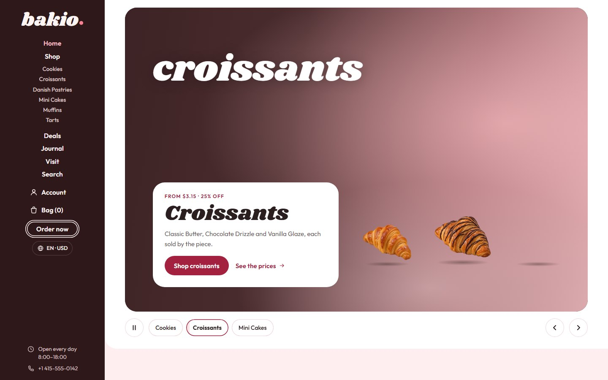 | 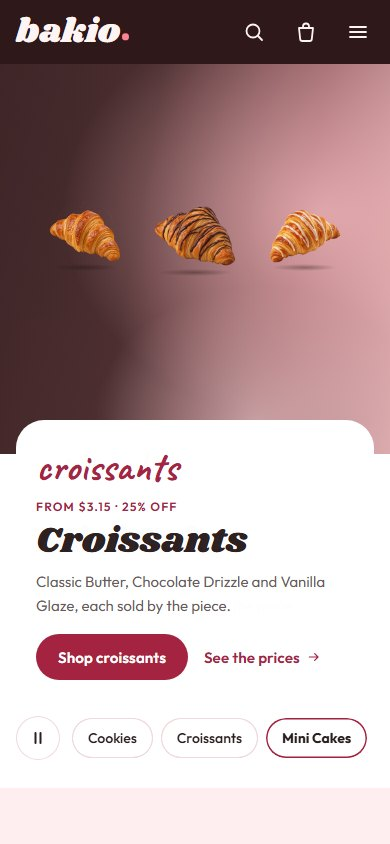 |
| 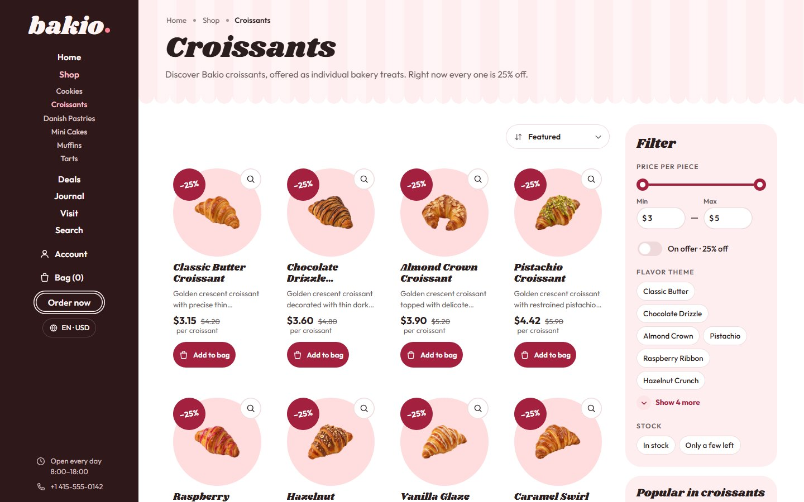 | 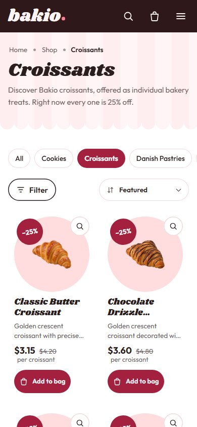 |
| 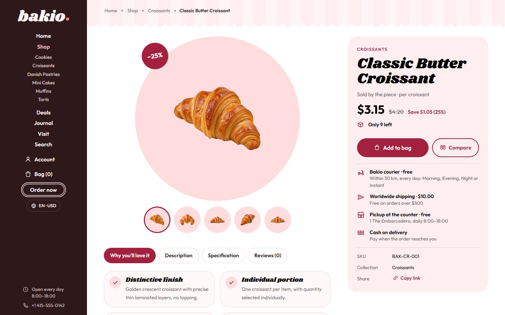 | 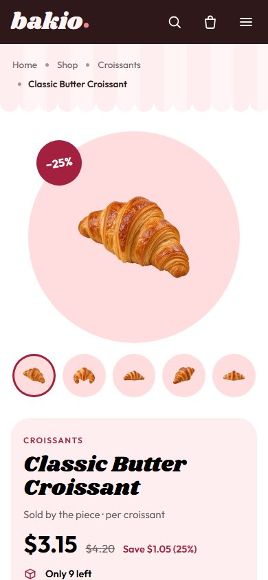 |
| 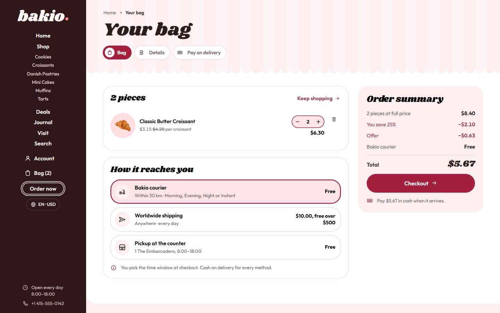 | 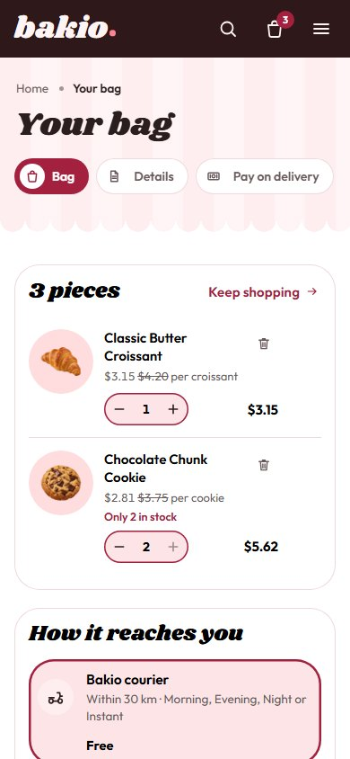 |
| 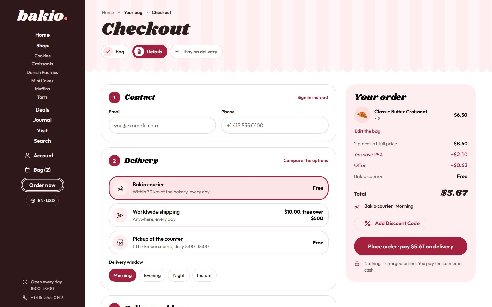 | 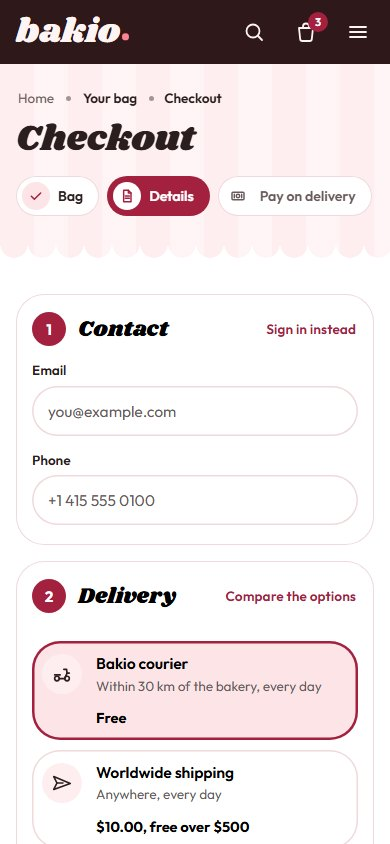 |

## Links

- Live shop: <https://galio.selldone.shop>
- Repository: <https://github.com/selldone-custom-layouts/official-galio>
- What Galio is, how the pages were built and its releases: [`GALIO.md`](https://github.com/selldone-custom-layouts/official-galio/blob/main/GALIO.md); the base it started from: [`BAKINI.md`](https://github.com/selldone-custom-layouts/official-galio/blob/main/BAKINI.md) and [`KALIO.md`](https://github.com/selldone-custom-layouts/official-galio/blob/main/KALIO.md)
- All official custom Layouts: <https://github.com/selldone-custom-layouts>
- Selldone: <https://selldone.com>
