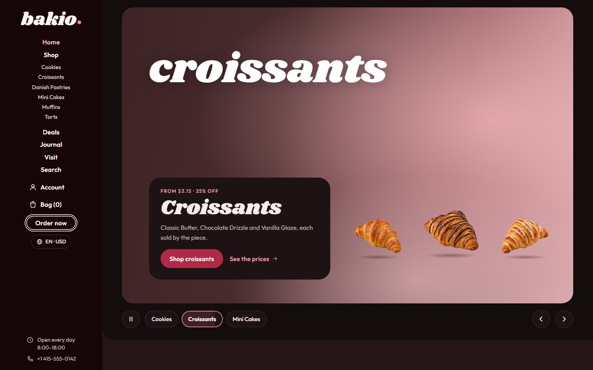
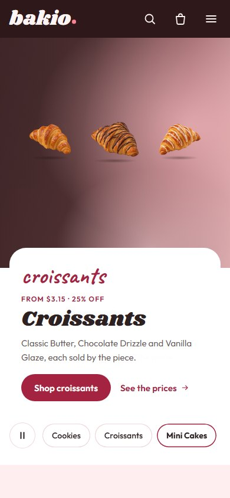
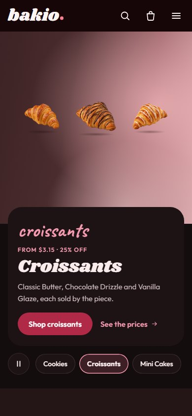

# Theme and colours

Galio runs the **shared theme switcher** (`components/theme-switcher/`), the same code as the other custom Layouts. Galio's palettes are in `components/galio/galio-theme.ts`. Since 1.0.3 every ground, band and plate comes from the palette's **one colour family**, computed by `components/galio/galio-family.ts` and mapped onto Galio's tokens by `style/galio/one.css`. The **one file a merchant edits** is `components/galio/galio-theme.settings.ts`.

## Galio's colours

Galio uses **one colour family**. Every colour on a page comes from one hue, the chosen palette's, plus white and the family's near-black. Switching the palette (Cherry, Pistachio, Blueberry, Cocoa, a Custom colour or a merchant's `brandColor`) re-tints the whole page: the bands, the plates, the rail, the footer and the buttons. There is no yellow anywhere unless the palette itself is yellow.

The **action colour** paints every button, chosen state and link: Cherry `#a3213f` (the default), Pistachio `#487434`, Blueberry `#2f5fb3` or Cocoa `#7a4a2c` in light mode. The saving sticker, the journal's date roundel and the wordmark's dot wear it too.

### The family

Light mode is white pages and cards with light tints of the hue; dark mode is the same family's night, deep tones of the same hue. The values below are Cherry's, the default:

| Token | What it is | Cherry, light | Cherry, dark |
| --- | --- | --- | --- |
| `--gl-fam-50` | the lightest tint | `#fff8f9` | `#1a1112` |
| `--gl-fam-100` | a light tint (bands, the buy box) | `#ffeeef` | `#241617` |
| `--gl-fam-200` | the plate tint | `#ffdcde` | `#311e20` |
| `--gl-fam-300` | the deepest tint (notes, hover on the dark bars) | `#fbbfc3` | `#40292b` |
| `--gl-fam-ink-bg` | the family's near-black (rail, top bar, banner band, footer, phone buy bar) | `#2e181a` | `#160608` |
| `--gl-fam-bg` | the page | `#ffffff` | `#140d0e` |
| `--gl-fam-surface` | cards | `#ffffff` | `#1d1314` |
| `--gl-fam-ink` | words | `#2a1e1f` | `#faeced` |
| `--gl-fam-muted` | quieter words | `#68595a` | `#cab9ba` |
| `--gl-fam-line` | lines | `#f0d9db` | `#372a2b` |

Beside them: `--gl-on-ink`, `--gl-on-ink-muted` and `--gl-on-ink-act` (the words and the brand's light tone on the dark bars; Cherry `#fff4f4`, `#ddc3c5` and `#ff8292`), the photo slots' painted ground (`--gl-fam-ph`, `--gl-fam-ph-art`) and the scrim behind sheets (`--gl-fam-scrim`).

Another palette gives another family. Pistachio, light: `fam-50` `#f6fcf4`, `fam-100` `#ebf7e6`, `fam-200` `#d9eed0`, `fam-300` `#bcdcaf`, and a dark forest rail `#172312` (`#060e03` in dark mode).

### Where each step goes

| Part | Colour |
| --- | --- |
| Home bands, top to bottom | Pick your pastry `fam-100`, Today's prices white, the "Sold by the piece" banner `fam-ink-bg`, Best sellers `fam-100`, Visit the counter white, From the journal `fam-50` |
| Inner pages | one tinted band at a time (a product page: the crumbs tinted, the product white, Buy together tinted, More white, the footer dark) |
| Cards inside a tinted band | white |
| Every pastry plate, thumbnail, mini row, quick look, gallery, Buy together, compare and phone buy bar plate | `fam-200` |
| Collection discs | white on the Pick your pastry band and in the rail's Shop menu, `fam-200` elsewhere |
| Saving sticker, the journal's date roundel | the brand (`--gl-act`, words in `--gl-act-on`) |
| Wordmark dot | the brand; on the dark bars, a light tone of the brand (`--gl-on-ink-act`) |
| Side rail, top bar, banner band, footer, phone buy bar | `fam-ink-bg`, words in `--gl-on-ink` |
| Rail and footer hover | the light mode's `fam-300`, in both modes (`--gl-on-ink-hi`) |
| Product page | the buy box `fam-100`; "Why you'll love it" cards `fam-50` with a family line; spec stripes `fam-50` |
| Notes, the "Sample text" label | `fam-300` with the family's ink |
| "How it reaches you" tiles without a photo | `fam-100` and `fam-200` in turn |
| Selldone's and Kalio's own parts | Vuetify's dark surfaces come from the family (`paintFamily()` in `galio-family.ts`); the base Layout's `--bk-*` grounds and words are mapped onto the family at the end of `style/galio.scss` |

Not recoloured: the real Mapbox map in Visit the counter and Contact (Mapbox's own style), and the product and journal photos (your content).

### How the family is computed

`components/galio/galio-family.ts` takes the palette's colour (each preset's own colour: Cherry `#a3213f`, Pistachio `#4e7a3a`, Blueberry `#2f5fb3`, Cocoa `#7a4a2c`; the visitor's Custom colour; or the merchant's `brandColor`), reads it in OKLCH, keeps its hue and caps its chroma at each step:

| Step | Light: lightness, chroma at most | Dark: lightness (chroma at most .035) |
| --- | --- | --- |
| `fam-50` | .985, .012 | .19 |
| `fam-100` | .962, .025 | .22 |
| `fam-200` | .925, .045 | .26 |
| `fam-300` | .86, .07 | .31 |
| `fam-ink-bg` | .24, .035 | .15 |

The words (`fam-ink`, `fam-muted`) stay near-neutral and take the hue lightly; they are made darker (lighter at night) until they read on the family's tints. A grey colour gives a grey family. The values are written on `<html>` as `--gl-fam-*` and `--gl-on-ink-*` for the current mode.

### The files, and the first paint

| File | What it does |
| --- | --- |
| `components/galio/galio-theme.settings.ts` | the merchant's choice: palette, brand colour, mode, switcher |
| `components/galio/galio-theme.ts` | the palettes' action colours and the switcher's config |
| `components/galio/galio-family.ts` | computes the family. `bootFamily()`, called in `storefront.ts` right after the theme switcher boots, writes the chosen palette's family on `<html>` and follows every palette, mode and Custom change |
| `style/galio/one.css` | generated by `scripts/galio-css.cjs` from the mockups' `g/one.css`: the Cherry family as plain CSS for light and dark, and Galio's tokens mapped onto the family. Never edit it |
| `style/galio/b.css` | the mockup's base tokens; `one.css` points the grounds, bands, plates, rail and footer among them at the family |
| the end of `style/galio.scss` | the base Layout's `--bk-*` grounds and words mapped onto the family, and the journal's date roundel in the brand |

`one.css` carries the Cherry family as plain CSS, so the first paint is right before any script runs. The chosen theme is painted before the first paint on every shop, so the other mode never flashes.

## On Galio's showcase shop

| Light (the default) | Dark |
| --- | --- |
|  |  |
|  |  |

The **Theme** row sits in the footer, in a strip of its own above the legal row. It is never in the side rail or the top bar. It holds:

- **Colour:** Cherry (the default), Pistachio, Blueberry, Cocoa, and **Custom colour** (any colour from the browser's colour picker; the whole family is built from it, and its action colour is made readable in light and dark against neutral greys of the family's lightness, so any hue works, with a note "Adjusted for readability" when it had to change).
- **Mode:** Light or Dark.

One click changes the whole site at once, with no reload: the family (every ground, band and plate, the rail and the footer), the action colour, the shared base, Vuetify's theme (`--v-theme-primary` follows the palette) and Selldone's own parts (the buy button, prices, the bag drawer, the checkout sheets, the payment window, dialogs). The choice is kept in the browser (key `galio-theme`; dark mode is the class `gl-dark` on `<html>`) and painted before the first paint, so the default never flashes. The arrow keys (and Home / End) move between the swatches.

## On your own shop

The visitor switcher is a **showcase** feature. With `themeSwitcher: "showcase"` it shows only on the Layout's own showcase shops (listed in `showcaseShops` in `components/galio/galio-theme.ts`; Bakio is one). On any other shop it is not shown, nothing is read from or written to the browser's storage, and Galio shows the theme from the settings file:

```ts
export const THEME_SETTINGS: ThemeSettings = {
  palette: "cherry",         // "cherry" | "pistachio" | "blueberry" | "cocoa"
  // brandColor: "#F5C400",  // any colour; replaces palette
  mode: "light",             // "light" | "dark"
  themeSwitcher: "showcase", // "showcase" | "on" (your visitors get it) | "off"
  textOnBrand: "auto",       // with brandColor: "auto" (a light brand keeps dark words) | "white"
};
```

| Setting | Allowed values |
| --- | --- |
| `palette` | `"cherry"` (the brand; the default), `"pistachio"`, `"blueberry"`, `"cocoa"` |
| `brandColor` | any `"#RRGGBB"`; when set it replaces `palette` |
| `mode` | `"light"` (white pages and the family's light tints; the default) or `"dark"` (the same family's night) |
| `themeSwitcher` | `"showcase"` (the visitor switcher shows only on the Layout's own showcase shops; the default), `"on"` (your visitors get the Theme row in the footer), `"off"` |
| `textOnBrand` | only with `brandColor`: `"auto"` (a light brand such as yellow keeps its colour, with dark words on it) or `"white"` (white words; a light colour is darkened) |

Every colour is made readable automatically: buttons, links, chosen states and dark mode. A palette or a brand colour re-tints the whole page: the grounds, the bands, the plates, the rail and the footer take its family, as well as the buttons.

## Examples

Change only these lines; leave the rest of the file as it is.

| You want | Set |
| --- | --- |
| "Use the yellow theme" | No palette is yellow, so use a brand colour: `brandColor: "#F5C400", textOnBrand: "auto"` (the whole page then takes a yellow family) |
| "My brand colour is #F5C400" | `brandColor: "#F5C400", textOnBrand: "auto"`; use `textOnBrand: "white"` for white words (the colour is then darkened) |
| "Make it dark" | `mode: "dark"` |
| "Let visitors switch themes" | `themeSwitcher: "on"` |
| "Remove the switcher" | `themeSwitcher: "off"` (on your own shop it is already hidden with `"showcase"`) |
| "Go back to the original colours" | remove `brandColor`, set `palette: "cherry", mode: "light"` |

Then build and upload a new version and put it live:

```bash
LAYOUT_ID=<your Layout id> PW=<playwright>/index.js SELLDONE_CLI_SRC=<cli clone> bash scripts/release.sh <new version> desk
```

See [Build and Upload](Build-and-Upload) and [Go Live](Go-Live).

## Contrast

| Palette | Action colour (light) | White words on it |
| --- | --- | --- |
| Cherry | `#a3213f` | 7.38:1 |
| Pistachio | `#487434` | 5.49:1 |
| Blueberry | `#2f5fb3` | 6.16:1 |
| Cocoa | `#7a4a2c` | 7.39:1 |

In dark mode, white words on every palette's action colour read at 5.04:1 or more. A custom or brand colour goes through `paletteFromColor()`, which moves only its lightness until each role reads against neutral greys of the family's lightness, so any hue works; the family is then built from the same colour.

Every surface is AA in every palette, light and dark, including the custom colours `#ffff00`, `#00ffff` and `#111111`. Because a palette re-tints every ground, the contrast check runs per palette and per custom colour, in both modes (see Checks below).

## Checks

Run these from the repository root after a theme change. They need Playwright; set `PW` to your install (`PW=<path>/node_modules/playwright`) if the default path is not yours. `".gl-ftr"` is the footer, which every page shows once it is ready.

1. **Contrast** on the live shop, at desktop and phone width. It must print `TOTAL 0`:
   ```sh
   PAGES="home=/,category=/<a category>,product=/product/<id>" \
     node components/theme-switcher/tools/contrast-audit.cjs https://<your shop> ".gl-ftr"
   ```
   To test one palette and mode, add `STORAGE='{"galio-theme":"{\"palette\":\"cherry\",\"mode\":\"dark\"}"}'` (this works where the switcher is shown).
2. **Bag drawer, bag page and address sheet.** It must print `TOTAL 0`. It fills a bag in the browser only and blocks every order request. The palette argument is a palette id, or `custom:#rrggbb` for a custom colour:
   ```sh
   SHOP=<your shop's xapi name> STORAGE_KEY=galio-theme WAIT=".gl-ftr" CART=".gl-bag-btn" \
     node components/theme-switcher/tools/cart-audit.cjs https://<your shop> cherry light
   ```
3. **Underlines and boxes.** No line under any word or icon, at rest or on hover; photos never on words, icon rows aligned. Each must print `TOTAL 0`:
   ```sh
   PAGES="home=/,category=/<a category>,product=/product/<id>" node scripts/underline-check.cjs https://<your shop> ".gl-ftr"
   SHOP=<your shop's xapi name> PAGES="home=/,category=/<a category>,product=/product/<id>" \
     node scripts/box-check.cjs https://<your shop> ".gl-ftr"
   ```
   Both default to the showcase shop's pages, so always pass `PAGES` (and `SHOP` for the box check, which also opens the menus, a quick look and the bag).
4. **Colour maths:** `node components/theme-switcher/theme-color.test.mjs` (Node 22.6 or newer).

On Galio's showcase shop the whole set runs with one command, one browser at a time: `bash scripts/run-checks.sh https://galio.selldone.shop <log folder>` (some of its checks use the shared kit's tools from a `new-shop-kits` folder beside the repository, which is not part of it). It uses `SHOP=bakio` and pages such as `category=/croissants-category` and `product=/product/720375`, in Cherry light and dark; its contrast check also runs in Pistachio, Blueberry and Cocoa, light and dark, and with the custom colours `#ffff00`, `#00ffff` and `#111111` in both modes.
