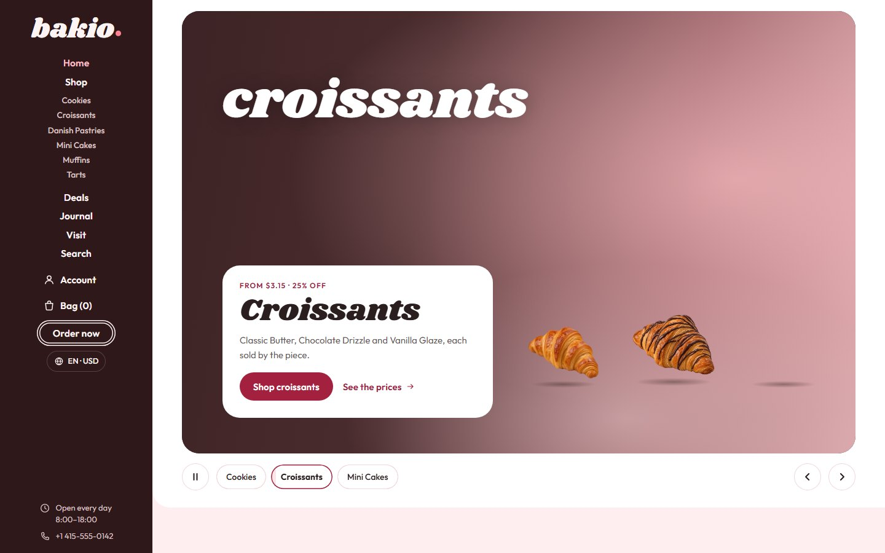

# Theme and colours

Galio runs the **shared theme switcher** (`components/theme-switcher/`), the same code as the other custom Layouts. Galio's palettes are in `components/galio/galio-theme.ts` and its grounds, lines and words for both modes are the mockup's own tokens in `style/galio/b.css` (generated by `scripts/galio-css.cjs`); the **one file a merchant edits** is `components/galio/galio-theme.settings.ts`.

## Galio's colours

Galio paints every action with **one colour**, cherry `#a3213f` (white words 7.38:1): every button, chosen states and links.

Around it, in the light mode (the default): white pages and cards, ink `#2b1a12`, muted words `#6b5549` and lines `#eadfd8`; the section bands in lemon `#fbf1c7`, strawberry `#fce4e7`, mint `#ddf1e6` and sky `#e2ecf8`; cocoa `#2e1c12` with cream words `#fff4ea` for the side rail, the top bar, the banner and the footer; lemon `#ffd84d` for the wordmark's dot and the saving stickers. Each collection's plate takes one of six sorbet tints, in the shop's order.

In the dark mode, the cocoa night: the page `#1a120d`, cards `#251a13`, raised parts `#2f2019`, ink `#fff1e6`, muted words `#cdb8ab`; the rail and the footer go to `#120b07`, the bands to deep versions of their colours, and cherry becomes `#b02a48` for buttons with `#f59ab0` for words and rings. Every colour is a token in `style/galio/b.css` (`:root` is light, `html.gl-dark` is dark).

The theme is painted before the first paint on every shop, so the other mode never flashes.

## On Galio's showcase shop

| Light (the default) | Dark |
| --- | --- |
|  |  |
|  |  |

The **Theme** row sits in the cocoa footer, in a strip of its own above the legal row. It is never in the side rail or the top bar. It holds:

- **Colour:** Cherry (the default), Pistachio, Blueberry, Cocoa, and **Custom colour** (any colour from the browser's colour picker; it is made readable in light and dark against Galio's own surfaces, the white page, the four bands and the cocoa night, with a note "Adjusted for readability" when it had to change).
- **Mode:** Light or Dark.

One click changes the whole site at once, with no reload: Galio's colours, the shared base, Vuetify's theme (`--v-theme-primary` follows the palette) and Selldone's own parts (the buy button, prices, the bag drawer, the checkout sheets, the payment window, dialogs). The choice is kept in the browser (key `galio-theme`; dark mode is the class `gl-dark` on `<html>`) and painted before the first paint, so the default never flashes. The arrow keys (and Home / End) move between the swatches.

## On your own shop

The visitor switcher is a **showcase** feature. With `themeSwitcher: "showcase"` it shows only on the Layout's own showcase shops (listed in `showcaseShops` in `components/galio/galio-theme.ts`; Bakio is one). On any other shop it is not shown, nothing is read from or written to the browser's storage, and Galio shows the theme from the settings file:

```ts
export const THEME_SETTINGS: ThemeSettings = {
  palette: "cherry",         // "cherry" | "pistachio" | "blueberry" | "cocoa"
  // brandColor: "#F5C400",  // any colour; replaces palette
  mode: "light",             // "light" | "dark"
  themeSwitcher: "showcase", // "showcase" | "on" (your visitors get it) | "off"
  textOnBrand: "auto",       // with brandColor: "auto" (a light brand keeps dark words) | "white"
};
```

| Setting | Allowed values |
| --- | --- |
| `palette` | `"cherry"` (the brand; the default), `"pistachio"`, `"blueberry"`, `"cocoa"` |
| `brandColor` | any `"#RRGGBB"`; when set it replaces `palette` |
| `mode` | `"light"` (white pages on sorbet bands; the default) or `"dark"` (the cocoa night) |
| `themeSwitcher` | `"showcase"` (the visitor switcher shows only on the Layout's own showcase shops; the default), `"on"` (your visitors get the Theme row in the footer), `"off"` |
| `textOnBrand` | only with `brandColor`: `"auto"` (a light brand such as yellow keeps its colour, with dark words on it) or `"white"` (white words; a light colour is darkened) |

Every colour is made readable automatically: buttons, links, chosen states and dark mode. The palette changes only the action colour; the white pages, the sorbet bands and the cocoa rail and footer stay as they are in every palette.

## Examples

Change only these lines; leave the rest of the file as it is.

| You want | Set |
| --- | --- |
| "Use the yellow theme" | No palette is yellow, so use a brand colour: `brandColor: "#F5C400", textOnBrand: "auto"` |
| "My brand colour is #F5C400" | `brandColor: "#F5C400", textOnBrand: "auto"`; use `textOnBrand: "white"` for white words (the colour is then darkened) |
| "Make it dark" | `mode: "dark"` |
| "Let visitors switch themes" | `themeSwitcher: "on"` |
| "Remove the switcher" | `themeSwitcher: "off"` (on your own shop it is already hidden with `"showcase"`) |
| "Go back to the original colours" | remove `brandColor`, set `palette: "cherry", mode: "light"` |

Then build and upload a new version and put it live:

```bash
LAYOUT_ID=<your Layout id> PW=<playwright>/index.js SELLDONE_CLI_SRC=<cli clone> bash scripts/release.sh <new version> desk
```

See [Build and Upload](Build-and-Upload) and [Go Live](Go-Live).

## Contrast

| Palette | Action colour (light) | White words on it |
| --- | --- | --- |
| Cherry | `#a3213f` | 7.38:1 |
| Pistachio | `#487434` | 5.49:1 |
| Blueberry | `#2f5fb3` | 6.16:1 |
| Cocoa | `#7a4a2c` | 7.39:1 |

Cherry words read at 6.11:1 on the strawberry band and 6.50:1 on the lemon band. In dark mode, white words on every palette's action colour read at 5.04:1 or more, and every palette's text colour reads at 7.86:1 or more on the dark card `#251a13` (Cherry's `#f59ab0` at 8.20:1). A custom or brand colour goes through `paletteFromColor()`, which moves only its lightness until each role reads against Galio's surfaces. The plates are tokens too: the collection's tint in light mode, a deep mix of it in dark mode.

## Checks

Run these from the repository root after a theme change. They need Playwright; set `PW` to your install (`PW=<path>/node_modules/playwright`) if the default path is not yours. `".gl-ftr"` is the footer, which every page shows once it is ready.

1. **Contrast** on the live shop, at desktop and phone width. It must print `TOTAL 0`:
   ```sh
   PAGES="home=/,category=/<a category>,product=/product/<id>" \
     node components/theme-switcher/tools/contrast-audit.cjs https://<your shop> ".gl-ftr"
   ```
   To test one palette and mode, add `STORAGE='{"galio-theme":"{\"palette\":\"cherry\",\"mode\":\"dark\"}"}'` (this works where the switcher is shown).
2. **Bag drawer, bag page and address sheet.** It must print `TOTAL 0`. It fills a bag in the browser only and blocks every order request. The palette argument is a palette id, or `custom:#rrggbb` for a custom colour:
   ```sh
   SHOP=<your shop's xapi name> STORAGE_KEY=galio-theme WAIT=".gl-ftr" CART=".gl-bag-btn" \
     node components/theme-switcher/tools/cart-audit.cjs https://<your shop> cherry light
   ```
3. **Underlines and boxes.** No line under any word or icon, at rest or on hover; photos never on words, icon rows aligned. Each must print `TOTAL 0`:
   ```sh
   PAGES="home=/,category=/<a category>,product=/product/<id>" node scripts/underline-check.cjs https://<your shop> ".gl-ftr"
   SHOP=<your shop's xapi name> PAGES="home=/,category=/<a category>,product=/product/<id>" \
     node scripts/box-check.cjs https://<your shop> ".gl-ftr"
   ```
   Both default to the showcase shop's pages, so always pass `PAGES` (and `SHOP` for the box check, which also opens the menus, a quick look and the bag).
4. **Colour maths:** `node components/theme-switcher/theme-color.test.mjs` (Node 22.6 or newer).

On Galio's showcase shop the whole set runs with one command, one browser at a time: `bash scripts/run-checks.sh https://galio.selldone.shop <log folder>` (some of its checks use the shared kit's tools from a `new-shop-kits` folder beside the repository, which is not part of it). It uses `SHOP=bakio` and pages such as `category=/croissants-category` and `product=/product/720375`, in Cherry light and dark and with a custom yellow.
